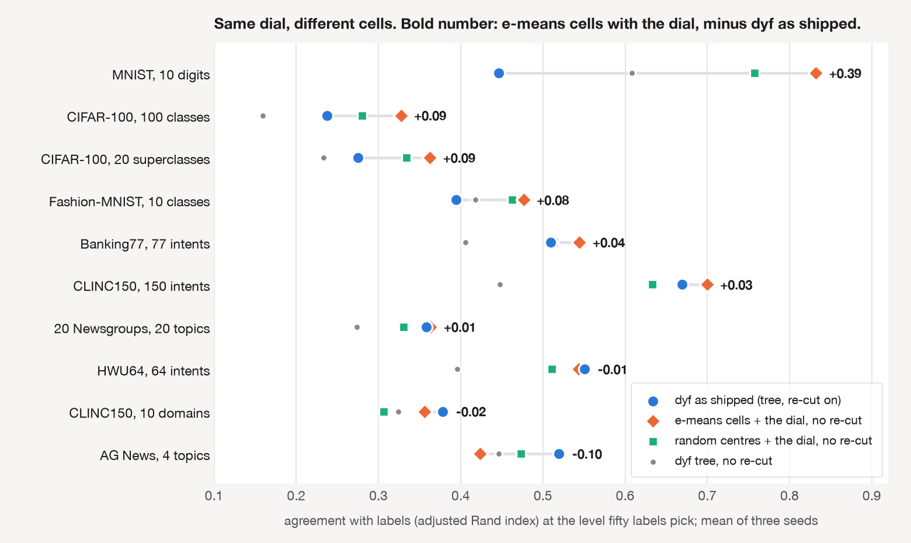
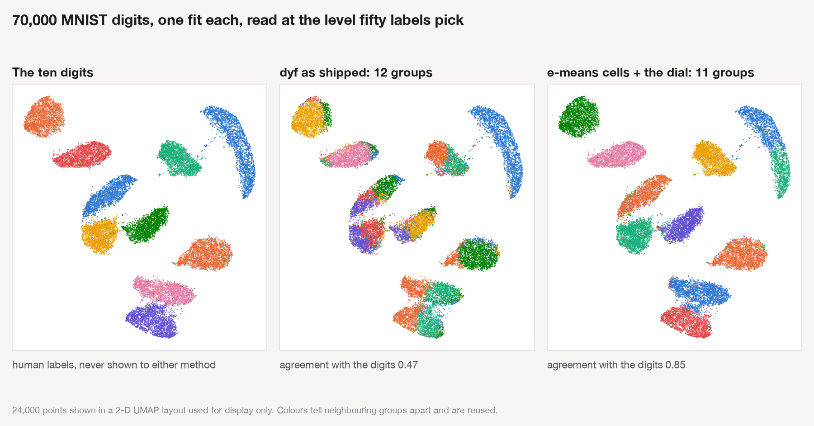

> A faster k-means still has to be told k. A dial that reads every k off one fit does not care where its cells came from.

Last week Swann Bessa, Pierre-Emmanuel Mazaré, Gergely Szilvasy, Hugo Touvron, David Picard, Matthijs Douze and Hervé Jégou published [*e-means: outperforming k-means (in one-tenth the epochs)*](https://arxiv.org/abs/2611.09501), developed at Meta FAIR, with a [project page](https://e-means.github.io/) and [code in faiss](https://github.com/facebookresearch/faiss/tree/main/contrib/e_means). It is mini-batch k-means with an exponential moving average, batch size and step set by scaling laws, and a rule that revives dead clusters. The abstract's claim is that it beats the loss Lloyd's algorithm reaches in 25 epochs after 1.4 to 2.6 epochs, at scales up to 16 million clusters.

One of the authors asked me a fair question: what does it do for [dyf](https://dyf.io)?

I ran four experiments to answer. The first two say "nothing". The last two turned the question around and found something I did not expect, mostly about my own code.

## What dyf does, in five steps

dyf groups embeddings so that you can change the level of detail after the fit. The [homepage](https://dyf.io) walks through it; the short version:

1. Cut the data into a few thousand small **cells** with a shallow tree of hyperplanes.
2. Take each cell's centre and link it to its ten nearest cell centres.
3. Run Louvain community detection on that graph at a **resolution** you choose. Low resolution gives a handful of groups, high resolution gives hundreds.
4. Carry each cell's group to its points.
5. **Re-cut**: move every point to its nearest group centre, for up to five rounds.

Steps 1 and 2 happen once. Changing the resolution repeats only 3 to 5, which takes a few hundredths of a second. That is the dial. About fifty labelled examples are enough to pick the right setting, and that is the score I use throughout: the adjusted Rand index (ARI, agreement with human labels, 1.0 is perfect) at the level fifty random labels choose.

::: {.callout-tip}
## Why fifty labels and not "the best k"
Every method here gets the same fifty labels, drawn 200 times. A method that only looks good at a level you could not have found does not get credit for it.
:::

## Experiment 1: e-means against k-means, told k

Before touching dyf I ran e-means the way it is meant to be run, against k-means on three intent datasets and up to six embedding models each (16 settings), at the true number of intents (64 to 150), ten seeds each.

- e-means beat Lloyd from the same random start by **+0.014** ARI.
- A k-means++ start beat a random start by **+0.036**.
- e-means given the k-means++ start reached a lower loss in 16 of 16 settings, by 0.07% to 0.52%, and moved ARI by **+0.005**.

At a hundred or so centroids the starting point matters about two and a half times more than the optimiser, and a loss that is half a percent lower does not show up in the labels. This is not the paper's regime, and it is not a criticism of the paper.

## Experiment 2: e-means inside dyf

dyf has exactly one k-means-shaped step: the re-cut. So I swapped it. Same tree, same graph, same Louvain groups, and then one of five things in step 5, on eight datasets and seven resolutions (70 dataset-layer-resolution cells):

| Replacement for the re-cut | Mean ARI change vs dyf as shipped | Cells above +0.02 | Cells below −0.02 |
|---|---:|---:|---:|
| e-means, started from dyf's groups | −0.002 | 1 | 4 |
| dyf's own loop, run to convergence | −0.003 | 0 | 5 |
| e-means, own random start | −0.010 | 3 | 13 |
| k-means++ | −0.014 | 1 | 22 |
| no re-cut | −0.033 | 7 | 41 |

: Swapping dyf's last step, at dyf's number of groups. {#tbl-recut}

e-means did what it promises. In five passes it reached a tighter solution than my loop did when run to convergence. The groups did not get better for it, and on MNIST, Fashion-MNIST and AG News they got slightly worse, as they did for every arm that optimised harder. It also took 0.13 to 1.8 seconds where the shipped loop takes 0.02 to 0.5, because dyf arrives at that step with few groups and a start that is already close.

So the answer to the question as asked is: no measurable effect. If the post ended here it would be a short one.

## Experiment 3: turn it around

e-means is built for thousands of centroids. dyf's step 1 makes thousands of cells. Nothing in steps 2 to 5 cares whether a cell came from a tree.

So I kept the dial and replaced the cells. Each arm gets exactly as many cells as dyf's tree produced for that dataset (roughly 900 to 3,500), then the identical graph, Louvain sweep over 16 resolutions, and re-cut:

- **dyf tree**: the shipped cells.
- **e-means**: a flat codebook, five passes.
- **Lloyd**: a flat codebook, 25 iterations, to tell whether a gain belongs to e-means or to any k-means.
- **random centres**: random data points as centres, one assignment pass, no optimisation at all.

With the re-cut on, across ten dataset-and-label-layer pairs and three seeds, the three flat arms beat the tree by about the same small amount: **+0.009** for e-means, **+0.009** for Lloyd, **+0.011** for random centres. The dial transfers. An e-means codebook gets every level of detail from one fit, at the same cost per level as dyf.

It is also not about e-means. Random centres do just as well, which should make anyone suspicious, and it made me look at what the re-cut was doing.

## Experiment 4: the same thing without the re-cut

Read at the best level in the sweep, the flat arms were far ahead of the tree *before* the re-cut, and the re-cut was erasing the difference. That was an after-the-fact reading at a level nobody could have picked, so I registered the honest version before running it again: the fifty-label pick with the re-cut off, on three fresh seeds, compared with dyf exactly as it ships.

{#fig-dotplot}

| Cells, re-cut off | Mean ARI change vs dyf as shipped | Above +0.02 | Below −0.02 |
|---|---:|---:|---:|
| e-means | **+0.059** | 6 of 10 | 2 |
| Lloyd, 25 iterations | +0.050 | 5 of 10 | 1 |
| random centres | +0.026 | 4 of 10 | 5 |
| dyf's own tree | −0.063 | 2 of 10 | 8 |

: The registered outcome: the level fifty labels pick, re-cut off, three fresh seeds. {#tbl-registered}

The bar I set was "above +0.02 on a majority of the ten". e-means clears it with six. Three things stand out.

**MNIST is the home court, and e-means runs up the score there.** dyf as shipped agrees with the ten digits at 0.45. e-means cells with the dial reach **0.83**, at eleven groups, without being told there are ten digits. K-means told ten gets about 0.40 on the same embedding.

{#fig-mnist}

**Without the re-cut, the optimiser finally matters.** e-means is ahead of Lloyd, and both are well ahead of random centres. Purer cells make better groups once nothing downstream is smoothing them over. e-means also makes those cells in about a third of Lloyd's time: 5.7 seconds against 19.0 on AG News (128,000 points, 3,500 cells), 1.8 against 7.8 on MNIST.

**The re-cut is a crutch for my tree.** Take the re-cut away from dyf's own cells and it loses on eight of ten. Take it away from e-means cells and it wins on six. The re-cut has been repairing weak cells, and on image data it damages good ones: with it on, the same e-means cells score 0.46 on MNIST.

## What I am taking from this

For e-means, there is a clustering method sitting one short step away from the codebook: build the centroid graph, run Louvain, and read any level you want. No k, one fit, and a refocus that costs a tenth of a second on 70,000 points.

For dyf, the tree is the weak part of the grouping, and I had not seen it because the re-cut was covering for it. That does not retire the tree. It is what makes the search index, the frozen partition I use for drift, and the warm-start refits that keep group ids stable over time, and none of those were tested here. It does mean the cells and the re-cut are both back on the table, and that a tree on top with small codebooks inside each branch is worth a proper test.

And the tree keeps one clear win. On AG News, four broad topics over 128,000 headlines, dyf as shipped beats e-means cells by 0.10. It has beaten every alternative cell-maker I have tried there. Coarse structure in text seems to be where hyperplane cells earn their keep.

## Honest accounting

- **MNIST carries the average.** Without it the e-means gain over shipped dyf is +0.023 across the other nine, with five above +0.02 and two below. The direction holds on all four image layers and is mixed on text.
- **The fourth experiment was registered after I had seen its outline.** The outcome and the bar were fixed before the rerun, and the rerun used seeds the first run never touched, but I knew which way it was likely to go.
- **This is an old recipe.** Over-segment with k-means, then merge the pieces with a graph method: people have done versions of this for a long time. Graph clustering directly on all 70,000 MNIST points does a little better still in my earlier runs (about 0.89). What is new here is small: that e-means makes the over-segmentation cheap, and that a resolution sweep plus fifty labels makes "how many groups" a setting and not a refit.
- **It still needs fifty labels.** At the default resolution the flat cells and the tree are indistinguishable on average.
- **Scale.** I used the NumPy reference implementation of e-means at 900 to 3,500 centroids on 10,000 to 128,000 points. The paper is about codebooks a thousand times larger. Timings are from one laptop.
- **The graph is the slow part.** Linking the cell centres takes longer than making the cells with the tree on every dataset (5.1 seconds against 0.9 on AG News). That is my bottleneck, not his.

The scripts, per-seed results and run logs are in the [dyf repository](https://github.com/jdonaldson/dyf/tree/main/benchmarks/intent_bench_2026_11). If you work on e-means and want to try the dial on a codebook at your scale, the three steps after the codebook are about forty lines, and I would like to know whether MNIST's 0.83 is a curiosity or the start of something.

## Reference

Swann Bessa, Pierre-Emmanuel Mazaré, Gergely Szilvasy, Hugo Touvron, David Picard, Matthijs Douze and Hervé Jégou. *e-means: outperforming k-means (in one-tenth the epochs)*. arXiv:2611.09501 [cs.LG], 6 November 2026. <https://arxiv.org/abs/2611.09501>. Project page: <https://e-means.github.io/>. Code: [`faiss/contrib/e_means`](https://github.com/facebookresearch/faiss/tree/main/contrib/e_means).

```bibtex
@misc{bessa2026emeansoutperformingkmeansin,
  title         = {e-means: outperforming k-means (in one-tenth the epochs)},
  author        = {Swann Bessa and Pierre-Emmanuel Mazaré and Gergely Szilvasy and Hugo Touvron and David Picard and Matthijs Douze and Hervé Jégou},
  year          = {2026},
  eprint        = {2611.09501},
  archivePrefix = {arXiv},
  primaryClass  = {cs.LG},
  url           = {https://arxiv.org/abs/2611.09501}
}
```

::: {.callout-note}
## Grounding note

Claims about e-means (what it is, the scale it targets, the comparison with 25 epochs of Lloyd) are from the [arXiv abstract](https://arxiv.org/abs/2611.09501), the [project page](https://e-means.github.io/) and the reference implementation in `faiss/contrib/e_means`; I ran the NumPy version (`NumpyEmeans`) with its default five epochs and spherical mode. The method, the name and every idea in it are the authors'; the only thing added here is dyf's graph-and-Louvain step on top of their codebook. All agreement numbers are adjusted Rand index against the datasets' own labels on L2-normalised embeddings: MiniLM for the five text sets, CLIP for CIFAR-100, and a 50-component PCA of the pixels for MNIST and Fashion-MNIST. Stochastic arms are means over three or five seeds as stated; the tree and graph in Experiment 2 are a single seed. The 0.40 for k-means on MNIST and the 0.89 for graph clustering on points come from earlier dyf benchmark runs on the same embedding, not from this post's scripts. I have no affiliation with Meta, and I will gladly correct anything I have got wrong about their work.
:::
